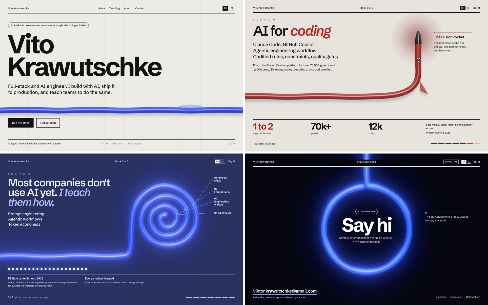

# The Path

Personal portfolio of Vito Krawutschke, full-stack and AI engineer in Cologne.
One glossy blue tube runs through the whole page and morphs into a new figure for every section: a falling sun, a timeline, a browser window, a backend coil, a data braid, an agent loop, a rocket, a teaching spiral and a closing loop.

**Live:** https://vitoleonardo.github.io/



## Stack

- TypeScript (strict), Vite, no UI framework
- three.js for the tube, rendered from one shared set of 520 points per figure
- GSAP ScrollTrigger and Lenis for pinned, scrubbed scroll
- Vitest and ESLint (type-aware), deployed to GitHub Pages by GitHub Actions

## How it works

The page plays like a 15 second film where scroll is the playhead.

```
scroll ─► Lenis ─► ScrollTrigger master timeline        src/motion/stage.ts
                     │
                     ▼
          locate(position) → scene + seconds            src/motion/score.ts
                     │
                     ▼
          scoreFrame() → PathFrame                      pure, no DOM, unit-tested
          (from/to figure, morph, red ink, night,
           sun, strands, nodes, rocket …)
                     │
                     ▼
          PathPort ─► WebGL renderer                    src/three/
          per-point morph wave, tube rebuilt in place,
          ripple and ink in the shaders, bloom only at night
```

- **`src/figures`** describes the figures in a 1280 × 720 design space. Desktop shapes are smoothed with Chaikin subdivision and resampled to even arc length, so any two figures can morph point by point.
- **`src/motion`** owns scroll: the pinned stage on desktop, the scene score, snapping between stops, keyboard and anchor navigation, and the per-section reveals for mobile and reduced motion.
- **`src/three`** builds the tube with parallel-transport frames and updates its buffers in place every frame. Extras (sun, data strands, agent nodes, rocket) hook into the same frame context. A blurred contact shadow sits under everything; an UnrealBloom pass runs only when the night scenes need it.
- **`src/content`** holds the English and German copy. `de/index.html` is generated from `index.html` before every dev and build run, so the two languages can't drift apart.

The timing decisions (scroll length per scene, morph durations, snap easing) are written down with their measurements in [docs/MOTION_PLAN.md](docs/MOTION_PLAN.md).

## Fallbacks and accessibility

- **Narrow screens (< 900 px):** scenes scroll natively and the path follows each section instead of a pinned stage.
- **Reduced motion:** a static stacked layout with plain fades and no WebGL.
- **No WebGL:** every figure ships as an inline SVG generated from the same shape data (`npm run fallbacks`).
- **Keyboard:** `↑ ↓` or `J K` step through the scenes, `1`–`0` jump, and the page counter opens a section menu.

## Development

Requires Node 22.18 or newer (the build scripts import TypeScript directly).

```sh
npm ci
npm run dev        # http://localhost:5173
npm run check      # typecheck, lint and tests
npm run build      # production build into dist/
npm run preview    # serve dist/ on http://localhost:4173
```

The tests cover the pure core: every scene boundary hands over without a visible jump, every scene plays without one, scrolling back reproduces the forward frames, and the geometry helpers (Chaikin, arc-length resampling, SVG path sampling).

### Scripts

| Command | What it does |
|---|---|
| `npm run de` | Generates `de/index.html` from `index.html` and `src/content/de.ts`; fails on conflicting translations |
| `npm run fallbacks` | Regenerates the inline SVG fallback figures in `index.html` from `src/figures/shapes.ts` |
| `npm run og` | Renders the social preview image `public/og.png` |
| `npm run capture` | Screenshots the client sites shown in the frontend stop into `public/work/` |
| `node scripts/record-motion.mjs` | Records a steady scroll through the site to `docs/motion/recording.webm` |
| `node scripts/measure-frames.mjs` | Scrolls the stack and reports frame intervals and long tasks |
| `scripts/motion-timing/` | Python tools that measure beat timing in the reference video and model the site's tempo (see its `requirements.txt`) |

## Deployment

Every push to `main` runs the checks and the build, then publishes `dist/` to GitHub Pages ([.github/workflows/deploy.yml](.github/workflows/deploy.yml)). Pull requests run the same checks without deploying.
