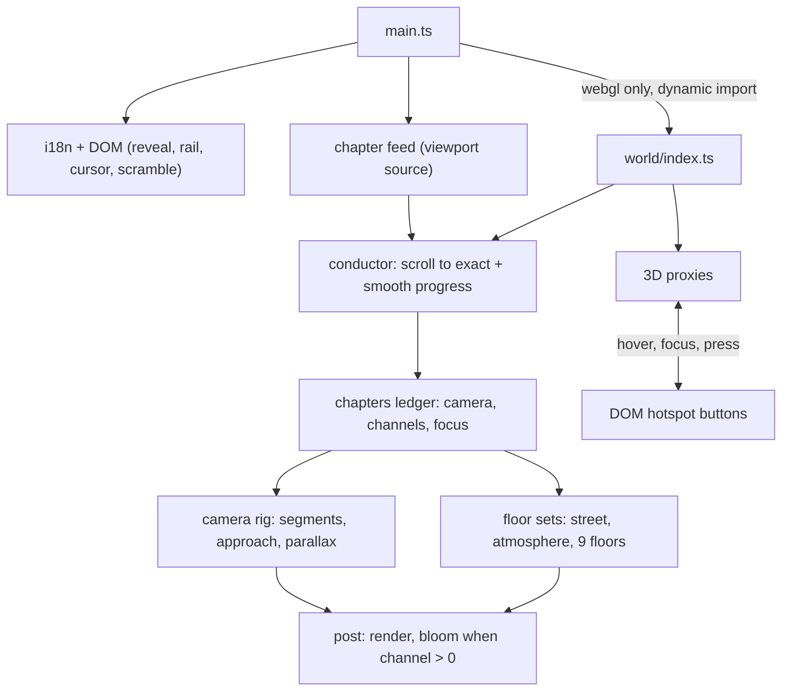

# The Tower

Personal portfolio of Vito Krawutschke, full-stack and AI engineer in Cologne.
The page is a night-lit engineering tower in Cologne that you climb by scrolling. Eleven chapters take the camera from the wet street up through seven floors of work, onto the roof and to the antenna beacon at dawn. English and German.

**Live:** https://vitoleonardo.github.io/

## Stack

- TypeScript (strict), Vite, no UI framework
- three.js 0.186 for the world, one fixed canvas behind native page scroll
- No GSAP, no Lenis: scroll position is the only input, a small conductor damps it
- Vitest and ESLint (type-aware), deployed to GitHub Pages by GitHub Actions

## Architecture



- **`src/main.ts`** wires the DOM layer first, so the page is complete and readable before any 3D code loads. The world is a lazy chunk, started only when WebGL exists.
- **`src/world/chapters.ts`** is the single ledger: per chapter the camera (desktop and mobile), the world channels (key, ambient, practicals, fog, rain, red, dawn, pulse, bloom, floorsLit, launch), the focused floors and the interaction ids.
- **`src/world/conductor.ts`** turns scroll into chapter progress, damped for the camera and exact for the DOM. `html[data-chapter]` carries the current chapter id.
- **`src/world/camera-rig.ts`** moves between chapter cameras, with an optional approach point so each stop is entered from a distance.
- **`src/world/floors/`** holds one factory per floor (frontend, backend, cloud, data, ai-core, rocket, teaching, lounge, beacon), built on the shared kit (materials, light ledger, emitters). `tower.ts` builds street, facade, slabs and stair core, `atmosphere.ts` sky, skyline, rain, dust and fog.
- **`src/world/interactions.ts`** keeps 3D proxies and DOM buttons in sync in both directions.
- **`src/world/post.ts`** runs a plain render until the bloom channel is above zero, then switches to the bloom chain.

The full specification is in [docs/WORLD_BIBLE.md](docs/WORLD_BIBLE.md).

## Fallbacks

- **No WebGL:** the `no-webgl` root class shows a poster image per chapter and the world is never loaded.
- **Reduced motion:** the world still renders, but progress snaps to the exact chapter, no smoothing, no parallax, instant scrolling, and scene clocks freeze.
- **Narrow screens (< 900 px):** every chapter has mobile camera overrides, copy becomes a bottom sheet.
- **Quality tiers:** high, medium and low, picked from device class and core count, and stepped down at runtime after sustained slow frames (see the bible).

## Accessibility

- Every 3D hotspot has a real DOM button (`data-hotspot`, `aria-pressed`) inside its chapter. Keyboard and screen reader users never need the canvas.
- The canvas is `aria-hidden`; the floor rail is a labelled navigation with `aria-current`.
- No-flash rule: light breathing has a period of at least 3.5 s, amplitude of at most 20 % and never more than one flash per second.

## Development

Requires Node 22.18 or newer.

```sh
npm ci
npm run dev        # http://localhost:5173
npm run check      # typecheck, lint and tests
npm run build      # production build into dist/
```

| Command | What it does |
|---|---|
| `npm run dev` | Vite dev server; generates `de/index.html` first |
| `npm run build` | Generates the German page, typechecks, builds into `dist/` |
| `npm run preview` | Serves `dist/` on http://localhost:4173 |
| `npm run check` | Typecheck, lint and tests in one go |
| `npm run typecheck`, `lint`, `test` | The three checks on their own |
| `npm run de` | Generates `de/index.html` from `index.html` and `src/content/de.ts` and fails on conflicting translations |
| `npm run og` | Renders the social preview image `public/og.png` |
| `npm run capture` | Screenshots the client sites shown in the frontend atelier into `public/work/` |

There is no posters script yet. The chapter posters referenced by `index.html` live in `public/posters/<id>.webp`.

## Deployment

Every push to `main` runs the checks and the build, then publishes `dist/` to GitHub Pages ([.github/workflows/deploy.yml](.github/workflows/deploy.yml)). Pull requests run the same checks without deploying.

## Previous version: The Path

The earlier portfolio, a single glossy tube that morphs through the sections, is preserved at tag [`the-path-v2.0.0`](https://github.com/vitoleonardo/vitoleonardo.github.io/releases/tag/the-path-v2.0.0) and on the branch `archive/the-path`.


